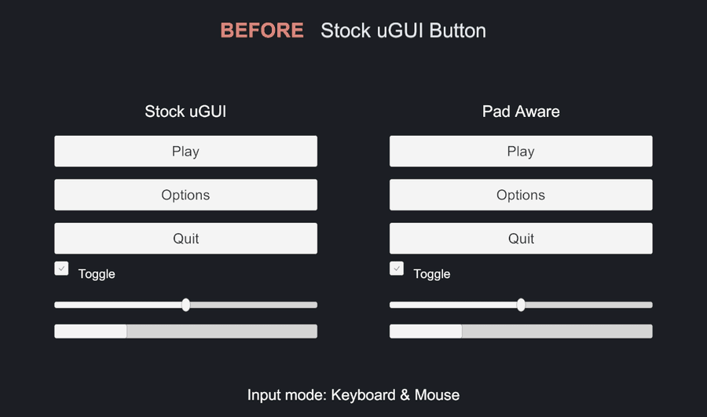

# Pad Aware UI


Drop-in uGUI `Button`, `Toggle`, `Slider` and `Scrollbar` variants that stop a resting mouse cursor from leaving a second item highlighted while the player navigates with a gamepad. 🎮

<!-- TODO: record Documentation~/before-after.gif and uncomment the line below.

-->

## The problem 🖱️ + 🎮

Point at a menu button with the mouse, leave the cursor there, and pick up the gamepad. The button under the cursor stays **Highlighted** while the gamepad moves the **Selected** state to other items, so two items look focused at once.

uGUI only leaves the Highlighted state on a pointer exit event. A cursor that does not move never sends one. Reports of this behavior on the Unity Issue Tracker have been closed as *By Design* or *Won't Fix*.

The usual workarounds each cost something:

- Setting **Navigation** to *None* removes the double highlight and also breaks gamepad navigation.
- Giving Highlighted the same look as Normal removes mouse hover feedback entirely.
- Hiding the cursor does not help, because the pointer stays inside the button and no exit arrives.

## The fix ✅

Each component in this package subclasses the stock uGUI control and overrides `DoStateTransition`:

```csharp
protected override void DoStateTransition(SelectionState state, bool instant)
{
    if (state == SelectionState.Highlighted && PadInputMode.UsingGamepad) state = SelectionState.Normal;
    base.DoStateTransition(state, instant);
}
```

When the input mode changes, the component re-applies `currentSelectionState`, so the hover highlight disappears as soon as the gamepad is used and returns when the mouse moves again. Selection, navigation, events and all serialized fields behave exactly as in the base control.

`PadInputMode` decides which device is in use. It installs a hidden runner after the first scene loads and switches to gamepad mode on a stick past 0.5, a d-pad press or any button press. It switches back on any key press, a mouse movement of more than 3 pixels in a frame, a mouse click or a scroll.

## Install 📦

In Unity 6.3, open **Window > Package Management > Package Manager**, choose **Install package from git URL**, and enter the following URL.

```text
https://github.com/schyro/unity-pad-aware-ui.git#v0.1.0
```

The package depends on `com.unity.ugui` and `com.unity.inputsystem`. Set **Project Settings > Player > Active Input Handling** to *Input System Package (New)* or *Both*, otherwise the Input System sees no devices and the input mode never changes.

## Usage 🛠️

**New controls:** add **UI > Pad Aware > Button** (or Toggle, Slider, Scrollbar) in **Add Component** instead of the stock component.

**Existing controls:** each Pad Aware type is a subclass of the stock one, so you can swap the script and keep every setting and event.

1. Select the GameObject and switch the Inspector to **Debug** mode from its ⋮ menu.
2. Drag `PadAwareButton` (or the matching type) onto the **Script** field of the `Button` component.
3. Switch the Inspector back to **Normal** mode.

The stock Inspectors for Button, Toggle, Slider and Scrollbar draw the Pad Aware types as well.

### Your own input detection

If your project already tracks the active device, turn off the built-in detection and push the state yourself:

```csharp
using Schyro.PadAwareUI;

PadInputMode.AutoDetect = false;
PadInputMode.SetUsingGamepad(playerInput.currentControlScheme == "Gamepad");
```

`PadInputMode.UsingGamepad` and the `PadInputMode.Changed` event are also available to your own scripts, for example to hide the cursor or swap button prompts.

### Other Selectables

`Dropdown`, `InputField`, `TMP_Dropdown` and `TMP_InputField` are not included. The same override works for any `Selectable` subclass: copy `PadAwareButton.cs` and change the base type.

## Notes

- Keyboard input counts as keyboard-and-mouse mode, so a resting cursor still shows its hover highlight during keyboard navigation.
- All types live in the `Schyro.PadAwareUI` namespace.

[MIT License](LICENSE.md)
